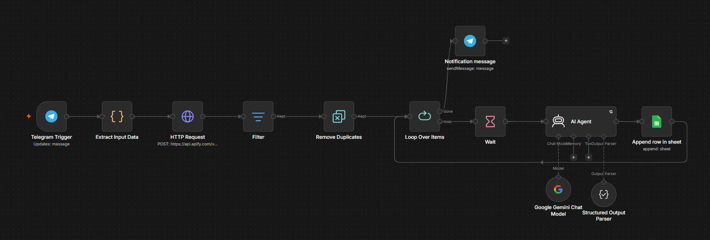

# 🤖 AI B2B Lead Generation & Qualification Agent (n8n + Gemini)

> **End-to-end Agentic Automation Pipeline** built in **n8n** to discover, deduplicate, and qualify potential B2B clients for software development, automation, and digital marketing services using **Apify**, **Google Gemini**, **Google Sheets**, and **Telegram**.

---

## 🎯 Problem & Solution

Manual B2B prospecting requires searching business directories, filtering irrelevant profiles, avoiding duplicate outreach, and drafting tailored value propositions. This workflow automates the entire pipeline from a single Telegram command:

1. **Command Ingestion & Scraping:** Captures target niche and location parameters via Telegram, triggering an automated extraction job through **Apify API**.
2. **Data Hygiene:** Filters incomplete records and removes duplicate prospects before LLM processing to optimize token usage.
3. **Agentic Qualification & Structured Output:** Iterates through clean leads with rate-limit control (`Loop` + `Wait`) and evaluates each prospect using an **AI Agent** powered by **Google Gemini** with a **Structured Output Parser** (enforcing strict JSON schemas).
4. **CRM Persistence & Alerts:** Appends qualified leads with personalized outreach angles directly into **Google Sheets** and sends a completion summary back to **Telegram**.

---

## 🏗️ Workflow Architecture

### Node Breakdown
- **`Telegram Trigger` & `Extract Input Data`:** Parses incoming search queries and target criteria sent by the user.
- **`HTTP Request` (Apify API):** Executes external web scraping / lead enrichment actors and retrieves raw prospect payloads.
- **`Filter` & `Remove Duplicates`:** Enforces data quality rules and eliminates redundant entries prior to AI inference.
- **`Loop Over Items` & `Wait`:** Batches records sequentially with controlled delays to respect API rate limits.
- **`AI Agent` + `Google Gemini Chat Model` + `Structured Output Parser`:** Analyzes business data, detects service needs (web, automation, social media), scores lead fit, and outputs deterministic JSON fields.
- **`Append row in sheet` & `Notification message`:** Logs structured lead data into Google Sheets and notifies the operator via Telegram once the batch completes.

---

## 🛠️ Tech Stack
- **Orchestration:** n8n (Self-Hosted)
- **LLM & AI Parsing:** Google Gemini Chat Model, LangChain AI Agent Node, Structured Output Parser
- **Data Extraction & Storage:** Apify REST API, Google Sheets API
- **Interface & Alerts:** Telegram Bot API