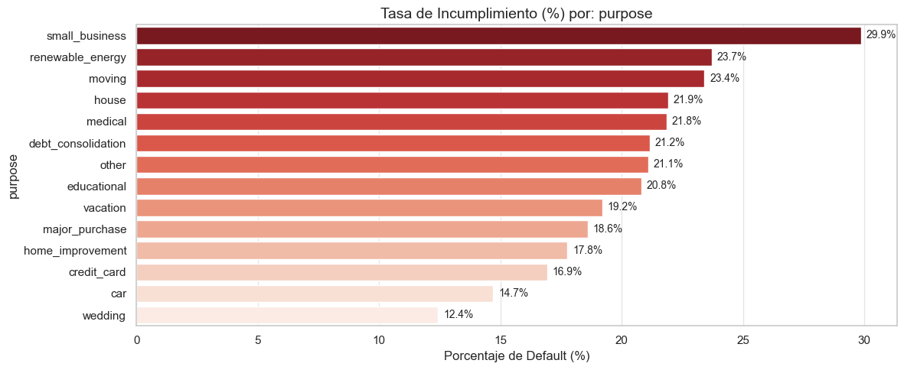
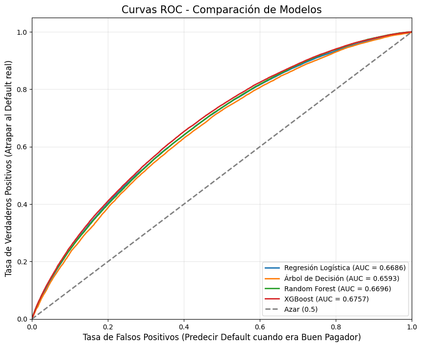
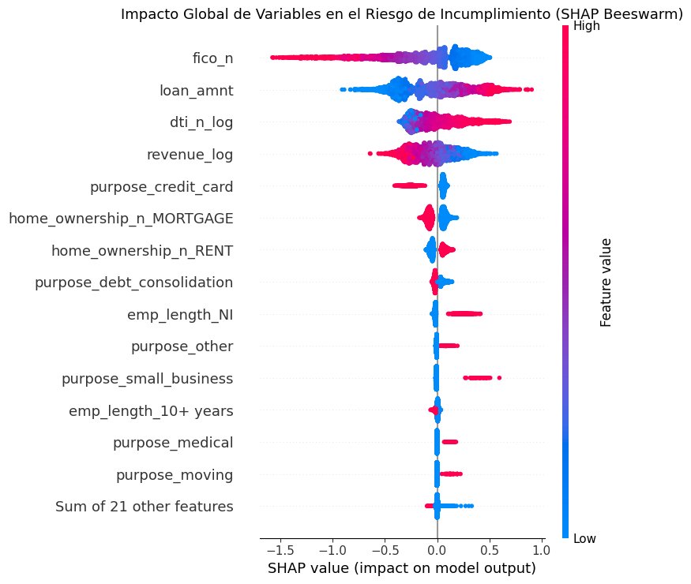
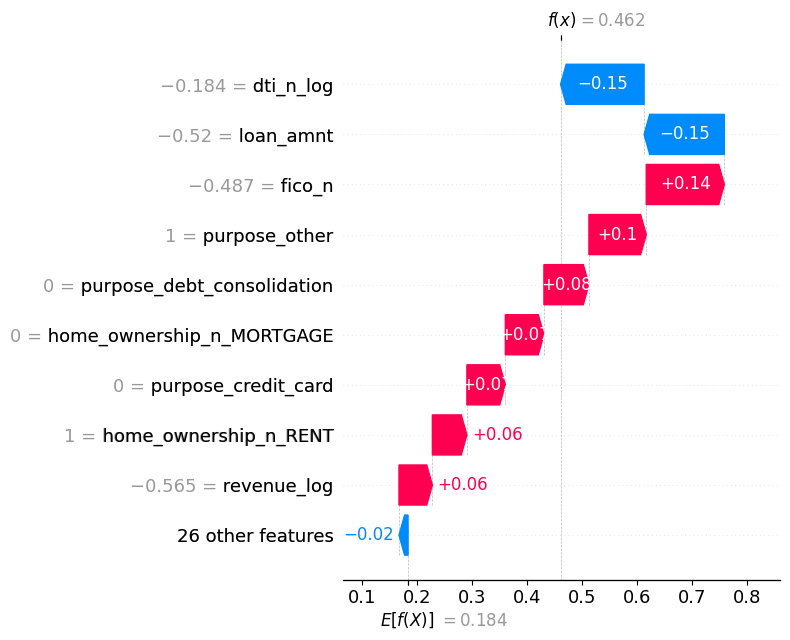

# 💳 Credit Risk Scoring & Explainable AI (XAI / SHAP)

> **End-to-end Machine Learning and Model Auditing pipeline** developed to predict loan default risk on **1.34M+ Lending Club records**, balancing predictive performance, financial business impact, and decision transparency through Cooperative Game Theory (**SHAP**).

---

## 🎯 Business Problem & Motivation

In banking and credit underwriting, black-box Machine Learning models can capture complex non-linear patterns across borrower profiles, yet they often fail to explain *why* a specific loan was approved or rejected. In high-stakes financial environments, regulatory compliance and risk auditing require both **accurate default detection** and **interpretable, human-readable justifications**.

This project addresses that trade-off by:
1. Optimizing a gradient boosting classifier aligned with a **custom net financial benefit matrix** rather than generic accuracy metrics.
2. Implementing **TreeSHAP** (`SHapley Additive exPlanations`) to provide global risk-driver insights and local, loan-level decision auditability.

---

## 🏗️ Pipeline Architecture & Methodology

To guarantee real-world validity and prevent data leakage, the workflow was structured into four modular stages:

1. **Exploratory Data Analysis & Risk Segmentation (`01_eda.ipynb`):**
   - Analyzed **1,347,681 historical loan records**, uncovering strong default-rate disparities across loan purposes—ranging from **12.4%** (wedding) and **14.7%** (car) up to **29.9%** for small business loans.
2. **Feature Auditing & Leakage Prevention (`02_auditoria_variables.ipynb`):**
   - Removed post-origination variables and identifiers (`id`, `desc`, `title`, `issue_d`, `addr_state`) to strictly preserve causal integrity at application time.
   - Applied logarithmic transformations to skewed financial distributions (`revenue_log`, `dti_n_log`) and enforced a strict **temporal train/test split** (Train: `2007–2016` | Test: `2016–2018`).
3. **Model Benchmarking & Business-Aligned Optimization (`03_model_training.ipynb`):**
   - Benchmarked Logistic Regression, Decision Tree, Random Forest, and **XGBoost** using ROC-AUC and a financial cost-benefit matrix (`+$1,000` per true good payer approved vs. `-$5,000` per defaulted loan approved).
   - Tuned hyperparameters via **Optuna** to maximize net financial return.
4. **Post-Hoc Explainability & Decision Auditing (`04_shap_analysis.ipynb`):**
   - Applied observational **TreeSHAP** over the champion XGBoost pipeline to decompose every prediction into exact marginal feature contributions.

---

## 📊 Key Results & Visual Evidence

### 1. Domain Risk Drivers (Exploratory Analysis)
Loan purpose acts as an immediate risk signal prior to modeling: commercial and liquidity-stressed segments (`small_business` at **29.9%**, `renewable_energy` at **23.7%**, `moving` at **23.4%**) exhibit more than double the default rate of asset-backed or planned personal loans (`car` at **14.7%**, `wedding` at **12.4%**).

---

### 2. Model Comparison & Champion Performance
Across out-of-time validation, **XGBoost** achieved the strongest discriminative capability (**AUC = 0.6757** on baseline comparison; **0.6781** post-Optuna tuning), outperforming Random Forest (**0.6696**), Logistic Regression (**0.6686**), and Decision Tree (**0.6593**).

| Model | ROC-AUC (Out-of-Time) | Key Takeaway |
| :--- | :---: | :--- |
| **XGBoost (Champion)** | **0.6781** | Best trade-off between default recall (`0.7103`) and net financial return |
| Random Forest | 0.6696 | Solid ensemble baseline, higher inference footprint |
| Logistic Regression | 0.6686 | Interpretable linear benchmark, misses non-linear interactions |
| Decision Tree | 0.6593 | High variance and lower generalization on unseen cohorts |

---

### 3. Global Explainability (SHAP Beeswarm)
Using **TreeSHAP**, the model's global decision logic aligns closely with financial domain intuition:
- **`fico_n` (FICO Score):** The single strongest predictor; higher credit scores (pink) strongly push predictions away from default, while lower scores (blue) increase risk.
- **`loan_amnt` & `dti_n_log`:** Larger requested loan amounts and higher Debt-to-Income ratios consistently drive default probability upward.
- **`revenue_log`:** Higher borrower income acts as a protective buffer against insolvency.
- **Categorical Signals:** Renting (`home_ownership_n_RENT`) and `small_business` / `other` loan purposes add positive risk pressure compared to mortgage holders (`home_ownership_n_MORTGAGE`) or credit card refinancing.

---

### 4. Local Decision Auditability (SHAP Waterfall)
For individual loan underwriting, SHAP decomposes a specific prediction ($f(x) = 0.462$ vs. baseline $E[f(X)] = 0.184$) into auditable factors:
- **Risk-Increasing Factors:** A low FICO score (`fico_n = -0.487`, contributing **+0.14**), loan purpose classified as `other` (**+0.10**), renter status (**+0.06**), and lower logged income (**+0.06**) push the risk score upward.
- **Mitigating Factors:** Moderate debt-to-income (`dti_n_log = -0.184`, **-0.15**) and a smaller loan amount (`loan_amnt = -0.52`, **-0.15**) partially offset the risk.

---

## 🛠️ Tech Stack
- **Data Processing:** Python, Pandas, NumPy, PyArrow (Parquet)
- **Machine Learning & Optimization:** XGBoost, Scikit-Learn, Optuna
- **Explainable AI (XAI):** SHAP (`TreeExplainer`)
- **Visualization:** Matplotlib, Seaborn

---

## 🔬 Methodological Scope & Delimitations
- **Observational TreeSHAP:** Employed for computational tractability over 1.3M+ records while preserving empirical feature correlations.
- **Scope Boundary:** Focused strictly on the trade-off between financial predictive utility and post-hoc mathematical explainability; demographic fairness auditing and adversarial perturbation testing are defined as future extensions.